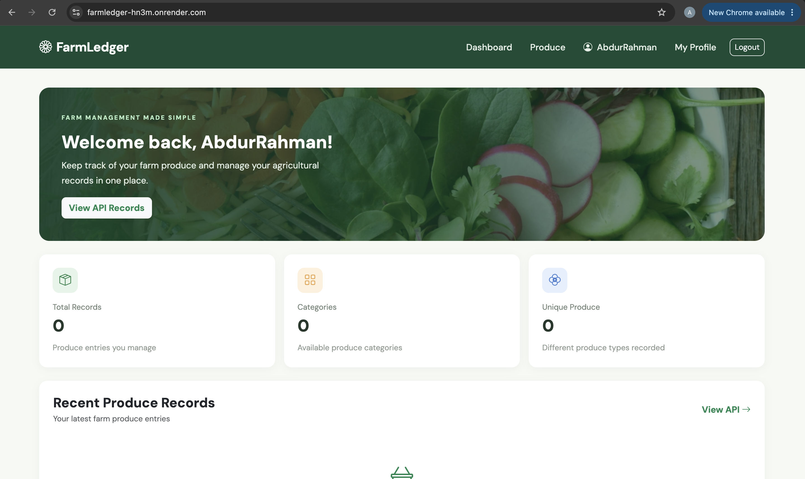
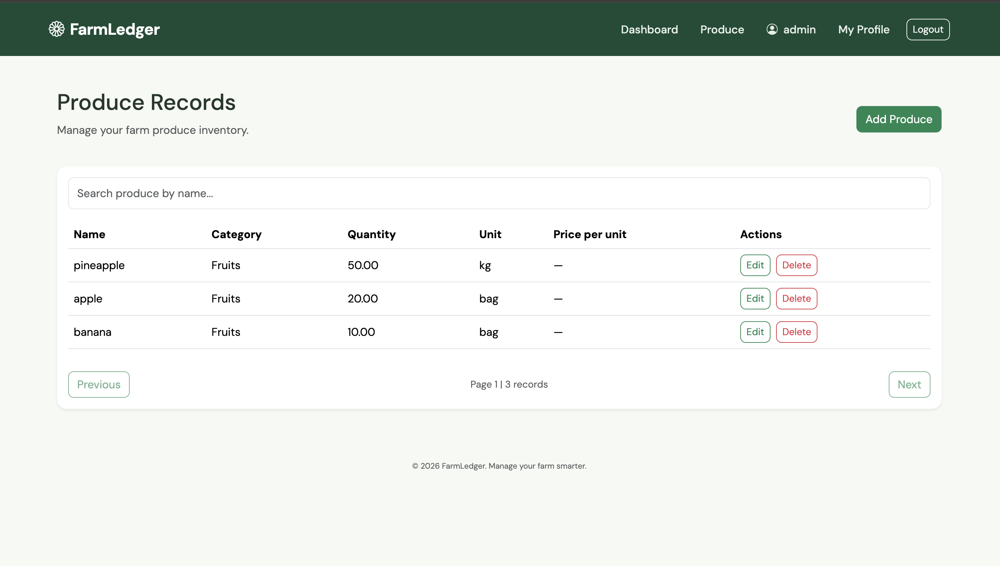

# FarmLedger 🌾

A Django-based farm produce management application that allows users to record, organise, and manage their agricultural produce.

**Live Demo:** https://farmledger-hn3m.onrender.com/

**Video Demo:** [Watch Demo](YOUR_VIDEO_LINK_HERE)

## Screenshots

<!-- Add your screenshots here -->





## Features

- User registration and authentication
- Dashboard with produce statistics
- Create, view, update, and delete produce records
- Categorise agricultural produce
- Search and paginate produce records
- User-specific record management
- Profile and password management
- REST API with Swagger documentation

## Tech Stack

- Python
- Django
- Django REST Framework
- PostgreSQL
- Bootstrap 5
- JavaScript
- drf-spectacular
- WhiteNoise
- Gunicorn

## Run Locally

**1. Clone the repository**

```bash
git clone YOUR_REPOSITORY_URL
cd FarmManager
```

**2. Install dependencies**

```bash
uv sync
```

**3. Create a `.env` file**

```env
SECRET_KEY=your-secret-key
DEBUG=True
DB_NAME=farmledger_db
DB_USER=postgres
DB_PASSWORD=your-password
DB_HOST=localhost
DB_PORT=5432
```

**4. Run migrations**

```bash
uv run python manage.py migrate
```

**5. Start the server**

```bash
uv run python manage.py runserver
```

Visit `http://127.0.0.1:8000/`.

## API Documentation

- [Swagger UI](https://farmledger-hn3m.onrender.com/api/docs/)
- [ReDoc](https://farmledger-hn3m.onrender.com/api/redoc/)

## Author

**Abdul-Rahman Ajidagba**

- [GitHub](https://github.com/Calaabdul)
- [LinkedIn](https://www.linkedin.com/in/abdul-rahman-ajidagba/)